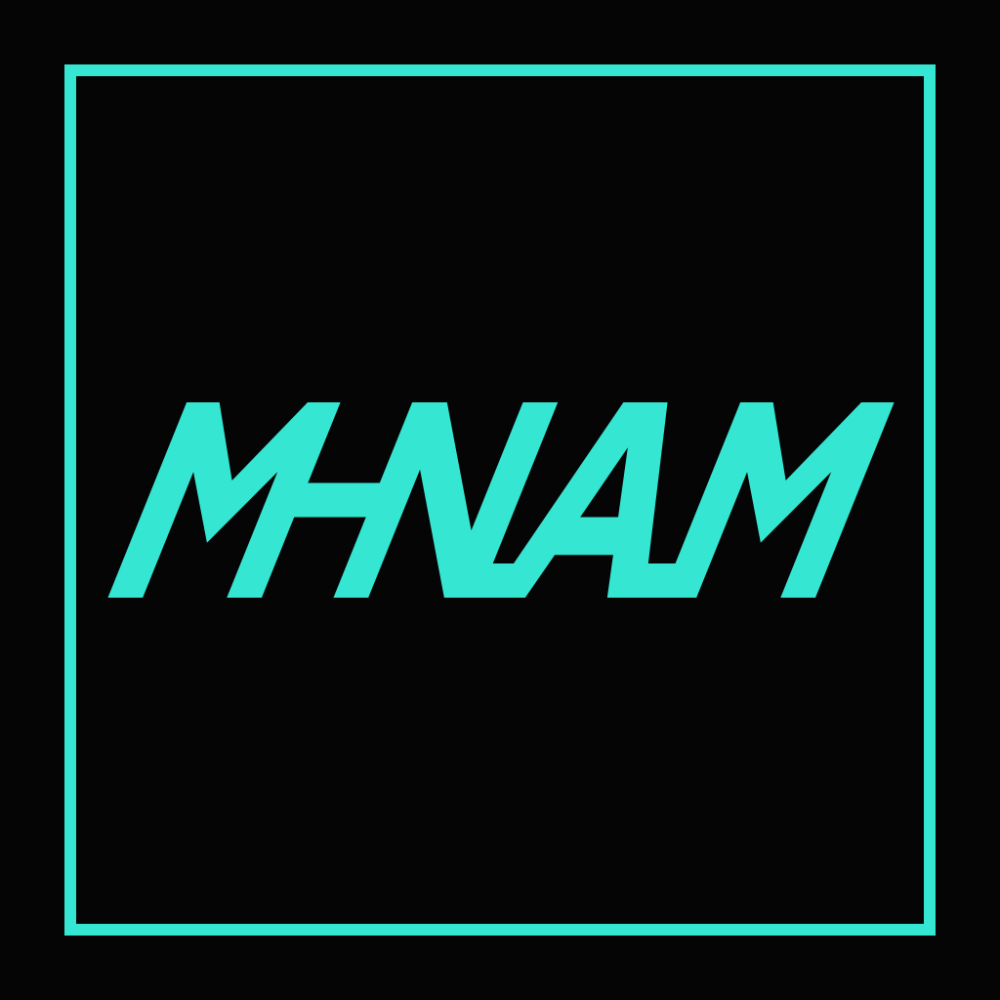
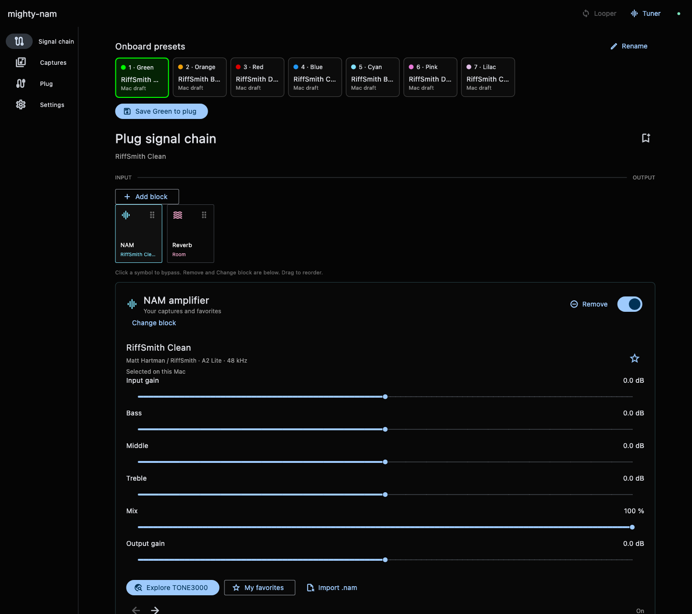
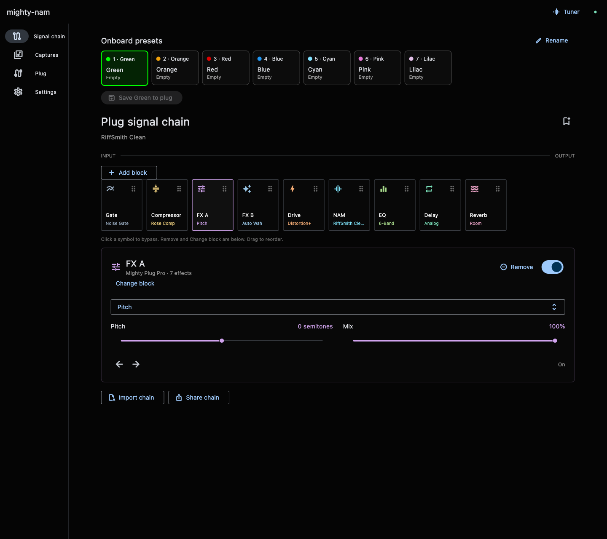
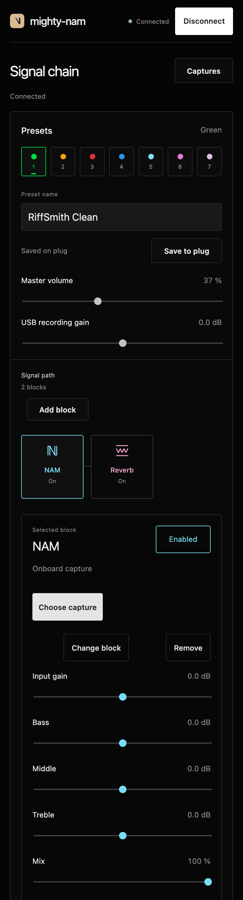
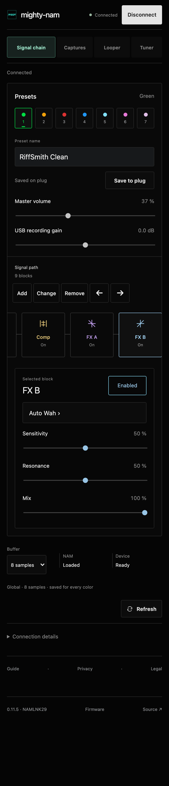

# mighty-nam

NAM A2 Lite on the NUX Mighty Plug Pro, with a Mac editor and a phone controller. 

[Local firmware builder](https://santismo.github.io/mighty-nam/looper-builder.html) · [Mac installer](https://github.com/santismo/mighty-nam/releases/tag/v0.6.1-preview.1) · [Phone controller](https://santismo.github.io/mighty-nam-controller/) · [User guide](https://santismo.github.io/mighty-nam/) · [Development](DEVELOPMENT.md) · [Roadmap](ROADMAP.md)

This repository contains the firmware experiments, Mac app, protocols and test evidence. The separate [mighty-nam-controller repository](https://github.com/santismo/mighty-nam-controller) is public and hosts the phone page.

**Amp-model replacement:** The main NAM block replaces the stock NUX amp models. You use NAM captures for the amp sound; the original NUX amp models are not selectable in this firmware. The supported stock effects remain available in the signal chain.

Current downloads: **NAMLNK29 revision 2 local builder**, **Mac 0.6.1**, and **phone controller 0.11.5** (restored 0.10.2 behavior). The stock-amp previews have been withdrawn; NAM remains the amp block.

## Current version

| Component | Status |
| --- | --- |
| Mac 0.6.1 | Universal ad-hoc-signed preview. TONE3000 picker stays open while loading captures; seven colored presets; live effects; tuner; master and recording gain; NAM input/output, bass/middle/treble and mix. NAMLNK23–29 support, both wah choices on 24–29, and a Looper panel on 26–29 (live input meter on 27+, saved loop settings on 28+). Independent lane controls are phone-only. Not notarized. |
| Phone 0.11.5 | Public Bluefy/Web Bluetooth controller with live editing, capture browsing/transfers, favorites, tuner, direct preset selection, FX A/B and global buffering and Looper controls with a live threshold meter on NAMLNK27+, optional saved loop settings on NAMLNK28 and a separate TONE3000 picker that keeps the controller page open. |
| Local builder 0.6.2 / NAMLNK29 r2 | Requires the exact public NUX `MP3_OR_V3.0.5.bin`. Includes seven editable colors using three MIT-licensed RiffSmith A2 Lite captures, Daisy-derived Auto Wah, 30/60-second looper, independent overdub lanes, undo/redo, seven-slot save fix, gestures and saved loop settings. Earlier NAMLNK28 and NAMLNK23 r2 remain selectable. Install your locally built image with the official NUX updater. |

The public builder variant passes offline cold-boot, preset-button and audio accuracy checks. NAMLNK23 has limited physical validation with private presets; the new starter bank, pitch timing and Logic duplex operation still need device tests. See [status](https://santismo.github.io/mighty-nam/status.html).

The development-unit owner reports Bluetooth music playback working with NAMLNK23 r2. [Bluetooth evidence and scope](docs/bluetooth-audio.md). NAMLNK24–29 development builds include Daisy-derived Auto Wah in FX A/B and retained NUX Touch Wah under Drive. NAMLNK25 passed a physical 30-second loop recording/playback check through three preset colors; the owner confirmed that the loop continued with its original sound. [Hardware result](evidence/looper-prototype/record-playback-hardware25.json). The owner tested NAMLNK26 phone recording/playback but reported scratchy 30-second overdubs and missed physical PRESET finishes. The [NAMLNK27 refinement](tools/looper-prototype/layers/README.md) adds a live input meter on the threshold slider in both controllers, carries the overdub encoder state across blocks, adds storage headroom and removes redundant physical-button debounce. Its fixes pass offline checks and still require a hardware/listening trial. The latest local builder includes NAMLNK29 and the licensed starter bank; its exact combined hardware trial is pending. [Wah details](docs/wah-prototype.md).

## What you can do

- Load compatible **48 kHz A2 Lite** captures. An A2 container is accepted only when its Lite component validates; full A2 is not supported.
- Add, move, change, bypass or remove blocks. Bypass keeps the tile/settings; removed or bypassed processors do not run in the active chain.
- Use stock gate, compressor, drive, cabinet, EQ, modulation, delay and reverb, plus **FX A** and **FX B** with Pitch, Auto Wah, Chorus, Flanger, Phaser, Tremolo and Vibrato. Pitch is −12 to +12 semitones; High / Low Cut has independent cutoffs.
- Save a capture and effects into each of seven colors. Recall any color in either controller or cycle occupied slots using PRESET.
- Set a global **8 / 16 / 32-sample** output buffer on NAMLNK18+. This is output staging, not measured end-to-end latency or extra processing capacity.
- Browse TONE3000, make the selected compatible capture active after confirmed transfer, and keep favorites. Full amp-and-cab captures bypass the separate cabinet block.

**Powered by [TONE3000](https://www.tone3000.com).** Captures belong to their creators. The integration uses user-authenticated requests; source repositories and Mac installers contain no catalog captures.

## Use it

On Mac, install the preview into Applications and connect the plug over a data-capable USB cable in normal mode. The installer does not flash firmware. On iPhone, open the [controller](https://santismo.github.io/mighty-nam-controller/) in Bluefy and tap Connect. Use one controller at a time. Controls apply live; **Save to plug** makes preset edits survive power-off. The buffer is saved globally on compatible firmware.

1. Get the public **V3.0.5 macOS ZIP** from [NUX](https://nuxaudio.com/product/mightyplugpro/) under Support → Firmwares. It includes **MP3_OR_V3.0.5.bin** and **NUX Device Updater 2.2.1.dmg**.
2. Open the [local builder](https://santismo.github.io/mighty-nam/looper-builder.html), select **MP3_OR_V3.0.5.bin**, and save the generated firmware and report. No compiler, firmware upload or connected plug is needed.
3. Follow the [installation guide](https://santismo.github.io/mighty-nam/looper-builder.html#install) to install your generated image with the official NUX updater in blinking-blue mode. Wait for success, then restart with POWER only.
4. Connect the Mac or phone controller in normal mode. Green = RiffSmith Clean, Orange = RiffSmith Bass Clean, Red = RiffSmith Distorted. NAMLNK29 revision 2 repeats these captures across all seven editable colors. Add effects and save your own A2 Lite captures into any color.

Installation replaces all onboard presets and global settings. Preserve anything you need first. The public builder does not incorporate the maintainer's private captures. Installing the Mac app alone preserves existing libraries and does not flash the plug.

The [offline builder ZIP](https://github.com/santismo/mighty-nam/releases/download/builder-v0.6.2-preview.1/mighty-nam-local-builder-0.6.2.zip) includes all build scripts. It contains original compiled changes and licensed starters, not NUX firmware or a complete hybrid image. Keep generated firmware local. There is no guaranteed recovery from arbitrary firmware damage.

## Interfaces

Current Mac 0.6.1 and phone 0.11.5, rendered with simulated connections and licensed example captures. Click a screenshot for full size.

| NAM + reverb | Expanded chain |
| --- | --- |
|  |  |

## Source, licenses and privacy

[MIT © 2026 santismo](LICENSE) applies to original project code. Retained third-party licenses still apply: see [notices](THIRD_PARTY_NOTICES.md). NUX firmware, bootloader and hardware design are not licensed by this project. The three RiffSmith starter captures retain their creator’s MIT license and attribution; other captures retain their individual terms. The current firmware is a stock-based hybrid, not a fully open replacement operating system or open hardware.

[Legal and distribution notes](LEGAL.md) explain license scope, external service terms and remaining review items. [Privacy](PRIVACY.md) describes local presets, credentials and direct service connections. No claim of manufacturer endorsement, legal clearance or guaranteed hardware recovery is made.

| Folder | Contents |
| --- | --- |
| `app/` | Flutter Mac editor and native CoreMIDI/TONE3000 integration |
| `firmware/` | Original DSP, hooks, local image tools and upstream notices |
| `spec/` | Protocols and persistence formats |
| `evidence/` | Build-specific offline and physical results |
| `docs/` | Guide source; public GitHub Pages guide |
| `tools/`, `scripts/`, `examples/` | Validation, packaging and extension examples |

Historical results stay scoped to their original build. See the [builder details](docs/local-builder.md), [USB/NAM changes](docs/usb-audio-nam-controls.md), and [latency investigation](docs/driver-phase-investigation.md). The latest builder includes the looper preview; the [archived NAMLNK23 builder](https://santismo.github.io/mighty-nam/builder-v23.html) remains available.

NAMLNK28 local-build preview adds saved looper settings, 100% default loop level, hold-to-overdub, tap-then-hold clear and one-step backward presets. [All plug gestures](https://santismo.github.io/mighty-nam/guide.html#gestures). Exact hardware validation remains pending.

### Seven-preset NAM-only revision

NAMLNK29 revision 2 adds CPU cache-line invalidation to the existing FlexSPI refresh after preset erase/program operations. An offline stale-read model reproduces the original slot-four save error; repeated writes, readback and restart across seven colors test the fix. This has not yet confirmed the physical cause or the result on hardware. Audio processing, NAM RAM placement, the output queue and controller commands remain on the pre-stock-amp baseline. Mac 0.6.1 and phone 0.11.5 remain compatible.
